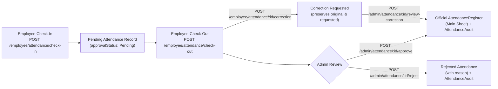

# Techneest HRMS, Attendance & Payroll Backend — API Documentation

## 1. Overview & Architecture
The **Techneest Dashboard Backend** is a modular, production-ready REST API built with **Node.js, Express 5, MongoDB, and Mongoose (CommonJS)**.

- **Base URL (Local)**: `http://localhost:5000`
- **Admin API Prefix**: `/api/v1/admin`
- **Employee API Prefix**: `/api/v1/employee`
- **Health Check**: `GET /api/v1/health`
- **Timezone Policy**: All timestamps are stored in **UTC** in MongoDB and formatted in **`Asia/Kolkata` (IST)** for human-readable fields and reports.

---

## 2. Environment Setup & Installation

### 2.1 Environment Variables (`backend/.env`)
Copy `backend/.env.example` to `backend/.env` and configure the following variables:

| Variable | Description | Example / Default |
| :--- | :--- | :--- |
| `PORT` | HTTP server port | `5000` |
| `NODE_ENV` | Environment mode (`development`, `test`, `production`) | `development` |
| `MONGO_URI` | MongoDB connection string | `mongodb+srv://...` |
| `JWT_SECRET` | Secret key for signing Access Tokens | *(min 32 chars)* |
| `JWT_ACCESS_EXPIRES_IN` | Access token TTL | `1d` |
| `JWT_REFRESH_SECRET` | Secret key for signing Refresh Tokens | *(min 32 chars)* |
| `JWT_REFRESH_EXPIRES_IN` | Refresh token TTL | `7d` |
| `ADMIN_SETUP_KEY` | Optional secret required for initial admin bootstrap | *(optional string)* |
| `CLIENT_URL` | Allowed CORS frontend origin | `http://localhost:5173` |
| `SMTP_HOST` | SMTP server hostname | `smtp.gmail.com` |
| `SMTP_PORT` | SMTP port (`587` for STARTTLS, `465` for SSL) | `587` |
| `SMTP_SECURE` | `true` for port 465, `false` for port 587 | `false` |
| `SMTP_USER` | SMTP authentication username/email | `hr@techneest.com` |
| `SMTP_PASSWORD` | SMTP authentication password / app password | `********` |
| `SMTP_FROM` | Sender identity for outgoing emails | `"Techneest HR <no-reply@techneest.com>"` |

### 2.2 Running the Server & Tests
```bash
# Start development server with nodemon
npm run dev

# Start production server
npm start

# Run unit tests (Payroll math, Attendance calculations, JWT helpers)
npm run test:unit

# Run full 53-step live HTTP integration test suite
npm test
```

---

## 3. Frontend `/admin/login` Page Specification

### Frontend Route Inspection Finding
During the analysis of `client/src/App.jsx` and `client/src/pages/Login.jsx`:
- The existing frontend defines a shared login page at `/login` (`client/src/pages/Login.jsx`) with a visual toggle between `Employee` and `Admin`, using local state.
- **A dedicated `/admin/login` route does not currently exist in `client/src/App.jsx`.**
- Per project requirements, **no frontend files were modified**. Below is the exact specification for implementing or connecting the `/admin/login` frontend page to the backend authentication endpoint.

### 3.1 Endpoint
- **Method & URL**: `POST /api/v1/admin/auth/login`
- **Authentication**: Public (Protected by `loginRateLimiter` — max 15 attempts per 15 minutes per IP, plus per-account lockout after 5 consecutive failed attempts for 15 minutes).

### 3.2 Required Frontend Form Fields (`/admin/login`)
1. **Email Address (`email`)**
   - Input type: `email`
   - Required: `true`
   - Validation: Valid email format, normalized to lowercase.
2. **Password (`password`)**
   - Input type: `password`
   - Required: `true`
   - Validation: Non-empty string (minimum 8 characters for Admin accounts).

### 3.3 Expected Request Payload
```json
{
  "email": "admin@techneest.com",
  "password": "StrongAdminPassword@123"
}
```

### 3.4 Validation Rules & Error Responses
- **`422 Unprocessable Entity`**: Returned when `email` is missing/invalid or `password` is empty.
  ```json
  {
    "success": false,
    "message": "Validation failed",
    "errors": [
      { "field": "email", "message": "Valid email is required", "value": "" }
    ]
  }
  ```
- **`401 Unauthorized`**: Returned when credentials are invalid (`Invalid admin email or password.`).
- **`423 Locked`**: Returned when the account is temporarily locked due to 5 consecutive failed login attempts.

### 3.5 Successful Response Structure (`200 OK`)
Sets `httpOnly` cookies (`accessToken`, `refreshToken`) and returns:
```json
{
  "success": true,
  "message": "Admin login successful",
  "data": {
    "accessToken": "<JWT_ACCESS_TOKEN>",
    "refreshToken": "<JWT_REFRESH_TOKEN>",
    "sessionId": "b63e4a1c-8c1e-4f0b-9e87-9f88e1d2a3b4",
    "admin": {
      "_id": "699b313dc290ef6265ebdb51",
      "name": "Vikram Aditya",
      "email": "admin@techneest.com",
      "phone": "+91 9876543210",
      "role": "Super Admin",
      "permissions": ["*"],
      "department": "Administration",
      "designation": "System Administrator",
      "lastLoginAt": "2026-10-22T16:38:46.110Z",
      "lastLoginIst": "22 Oct 2026, 10:08:46 pm"
    }
  }
}
```

---

## 4. Core Business Workflows

### 4.1 Initial Admin Setup (`POST /api/v1/admin/auth/setup`)
No default admin credentials are hardcoded. When the database has **zero** admin accounts:
1. Call `POST /api/v1/admin/auth/setup` with `{ name, email, password, phone, setupKey }`.
2. The system seeds default RBAC roles (`Super Admin`, `HR Admin`, `Payroll Admin`, `Employee`), default `AttendancePolicy` (`Standard General Shift`), and core `Department` records (`Engineering`, `Product`, `Design`, `Marketing`, `Sales`, `HR`).
3. Any subsequent call to `/api/v1/admin/auth/setup` returns **`403 Forbidden`** (`Initial admin setup has already been completed.`).

### 4.2 Employee Login & Activity Tracking vs. Attendance Separation
- When an employee logs in via `POST /api/v1/employee/auth/login`, the backend:
  1. Creates an active `Session` record.
  2. Records an immutable `LoginHistory` entry with UTC timestamp, IST date (`YYYY-MM-DD`), IST time (`hh:mm:ss A`), IP address, and parsed browser/OS metadata.
  3. **Does NOT create or approve any `Attendance` record.**
- Admins can audit all logins, active sessions, and session durations via:
  - `GET /api/v1/admin/activity/logins`
  - `GET /api/v1/admin/activity/sessions`
  - `GET /api/v1/admin/activity/summary`
  - `GET /api/v1/admin/employees/:id/login-history`

### 4.3 Employee Self-Attendance & Admin Approval Workflow


1. **Check-In (`POST /api/v1/employee/attendance/check-in`)**: Uses server UTC time, compares against the employee's `AttendancePolicy` (`shiftStartTime` + `gracePeriodMinutes`), flags `isLateArrival` and `lateMinutes`, and sets `approvalStatus = "Pending"`. Duplicate daily check-ins are blocked with `409 Conflict`.
2. **Check-Out (`POST /api/v1/employee/attendance/check-out`)**: Computes `workingMinutes`, `workingHours`, `isEarlyCheckout`, `isHalfDay`, and `overtimeHours`.
3. **Admin Approval (`POST /api/v1/admin/attendance/:id/approve`)**:
   - Marks `Attendance.approvalStatus = "Approved"`.
   - Upserts the verified record into `AttendanceRegister` (official main sheet) with `dayCredit` (`1`, `0.5`, or `0`).
   - Appends an immutable `AttendanceAudit` entry.
   - Sends an in-app `Notification` to the employee.
4. **Admin Rejection (`POST /api/v1/admin/attendance/:id/reject`)**: Requires `remarks`, removes any register entry if previously present, logs `AttendanceAudit`, and notifies the employee.

### 4.4 Automatic Salary & Payroll Calculation Engine
1. **Configure Salary Structure (`PUT /api/v1/admin/payroll/structures/:employeeId`)**:
   - Supports `calculationBasis`: `CALENDAR_DAYS`, `WORKING_DAYS`, or `FIXED_30_DAYS`.
   - Configurable components: `basicSalary`, `hra`, `da`, `specialAllowance`, `conveyanceAllowance`, `medicalAllowance`, `otherAllowances`.
   - Configurable statutory rules: PF (`pfConfig`), ESI (`esiConfig`), Professional Tax (`professionalTaxConfig`), TDS (`tdsPercent`), and Overtime multiplier (`overtimeConfig`).
2. **Generate Draft Payroll (`POST /api/v1/admin/payroll/generate`)**:
   - Reads **only** approved `AttendanceRegister` records, approved `Leave` records, and `Holiday` records for the target `month` and `year`.
   - Calculates `payableDays`, `lopDays`, prorated earnings, overtime pay, statutory deductions, and rounded INR `netPayable`.
   - Creates payroll in `Draft` status with `paymentStatus = "Pending"`. Duplicate generation for a finalized period is blocked with `409 Conflict`.
3. **Adjustments & Recalculation**:
   - Admins can add bonuses, incentives, or deductions (`POST /api/v1/admin/payroll/:id/adjustments`) and recalculate (`POST /api/v1/admin/payroll/:id/recalculate`) while in `Draft` or `Approved` state.
4. **Payroll Approval (`POST /api/v1/admin/payroll/:id/approve`)**:
   - Transitions `payrollStatus` from `Draft` to `Approved`.
   - **Important**: `paymentStatus` remains `"Pending"` until actual disbursement is recorded.
5. **Payroll Finalization (`POST /api/v1/admin/payroll/:id/finalize`)**:
   - Locks `isLocked = true` and stores an `immutableSnapshot` of employee details, bank details, salary structure, attendance breakdown, earnings, and deductions.
   - Locks the month's `AttendanceRegister` rows (`isLockedForPayroll = true`).
   - Automatically generates a PDF salary slip (`backend/uploads/payslips/`) and dispatches/logs the email via Nodemailer.
6. **Payment Status Update (`PATCH /api/v1/admin/payroll/:id/payment-status`)**:
   - Records `paymentStatus` (`Pending`, `Processing`, `Paid`, `Failed`), `paymentReference` (UTR/transaction ID), `paymentMethod`, and `paidAt`.

---

## 5. Complete Endpoint Reference

### 5.1 System & Health
| Method | Endpoint | Access | Description |
| :--- | :--- | :--- | :--- |
| `GET` | `/api/v1/health` | Public | Server health, DB state, and SMTP status |

### 5.2 Admin Authentication (`/api/v1/admin/auth`)
| Method | Endpoint | Access | Description |
| :--- | :--- | :--- | :--- |
| `POST` | `/api/v1/admin/auth/setup` | Public (1-time) | Initial admin bootstrap & default data seed |
| `POST` | `/api/v1/admin/auth/login` | Public | Admin login with lockout & session tracking |
| `POST` | `/api/v1/admin/auth/refresh-token` | Public | Rotate refresh token & issue new access token |
| `POST` | `/api/v1/admin/auth/forgot-password` | Public | Generate password reset token & send email |
| `POST` | `/api/v1/admin/auth/reset-password` | Public | Reset password using valid token |
| `POST` | `/api/v1/admin/auth/logout` | Admin | Revoke current admin session & update login log |
| `GET` | `/api/v1/admin/auth/profile` | Admin | Get current admin profile |
| `PUT` | `/api/v1/admin/auth/profile` | Admin | Update admin profile & avatar |
| `PUT` | `/api/v1/admin/auth/change-password` | Admin | Change admin password & revoke other sessions |
| `GET` | `/api/v1/admin/auth/sessions` | Admin | List admin sessions |
| `DELETE` | `/api/v1/admin/auth/sessions/:sessionId` | Admin | Revoke specific admin session |
| `GET` | `/api/v1/admin/auth/login-history` | Admin | Paginated admin login audit history |

### 5.3 Admin Dashboard, Reports & Settings (`/api/v1/admin`)
| Method | Endpoint | Access | Description |
| :--- | :--- | :--- | :--- |
| `GET` | `/api/v1/admin/dashboard` | Admin | KPIs, department distribution, attendance & payroll stats |
| `GET` | `/api/v1/admin/reports` | Admin | Comprehensive analytics for `Reports.jsx` |
| `GET` | `/api/v1/admin/audit-logs` | Admin | Paginated system-wide security & action audit logs |
| `GET` | `/api/v1/admin/settings` | Admin | Get admin profile, organization settings, policies & roles |
| `PUT` | `/api/v1/admin/settings/organization` | Admin | Update organization settings & notification toggles |
| `GET` | `/api/v1/admin/settings/roles` | Admin | List RBAC roles |
| `POST` | `/api/v1/admin/settings/roles` | Admin | Create custom RBAC role |
| `PUT` | `/api/v1/admin/settings/roles/:id` | Admin | Update RBAC role permissions |
| `GET` | `/api/v1/admin/notifications` | Admin | List admin notifications |
| `PATCH` | `/api/v1/admin/notifications/:id/read` | Admin | Mark notification as read |
| `POST` | `/api/v1/admin/smtp/verify` | Admin | Verify Nodemailer SMTP connection |

### 5.4 Admin Department Management (`/api/v1/admin/departments`)
| Method | Endpoint | Access | Description |
| :--- | :--- | :--- | :--- |
| `GET` | `/api/v1/admin/departments` | Admin | List departments with live headcount, task & attendance stats |
| `POST` | `/api/v1/admin/departments` | Admin | Create department |
| `GET` | `/api/v1/admin/departments/:id` | Admin | Get department details & employee roster |
| `PUT` | `/api/v1/admin/departments/:id` | Admin | Update department |
| `DELETE` | `/api/v1/admin/departments/:id` | Admin | Delete empty department |

### 5.5 Admin Employee Management (`/api/v1/admin/employees`)
| Method | Endpoint | Access | Description |
| :--- | :--- | :--- | :--- |
| `POST` | `/api/v1/admin/employees` | Admin | Create employee (+ optional initial salary structure) |
| `GET` | `/api/v1/admin/employees` | Admin | List employees with pagination, search, department & status filters |
| `GET` | `/api/v1/admin/employees/:id` | Admin | Full employee profile (`ViewEmployee.jsx`) |
| `PUT` | `/api/v1/admin/employees/:id` | Admin | Update employee (`EditEmployee.jsx`) |
| `PATCH` | `/api/v1/admin/employees/:id/status` | Admin | Activate / deactivate employee & revoke sessions |
| `PATCH` | `/api/v1/admin/employees/:id/role` | Admin | Assign role & permissions to employee |
| `POST` | `/api/v1/admin/employees/:id/documents` | Admin | Upload employee document (`multipart/form-data` or metadata) |
| `DELETE` | `/api/v1/admin/employees/:id/documents/:docId` | Admin | Delete employee document |
| `GET` | `/api/v1/admin/employees/:id/login-history` | Admin | Employee-specific login history |
| `GET` | `/api/v1/admin/employees/:id/attendance-summary` | Admin | Employee monthly attendance summary |
| `GET` | `/api/v1/admin/employees/:id/payroll-history` | Admin | Employee payroll & payslip history |

### 5.6 Admin Login & Activity Tracking (`/api/v1/admin/activity`)
| Method | Endpoint | Access | Description |
| :--- | :--- | :--- | :--- |
| `GET` | `/api/v1/admin/activity/logins` | Admin | Date-wise & employee-wise login history |
| `GET` | `/api/v1/admin/activity/sessions` | Admin | View active/revoked employee sessions |
| `DELETE` | `/api/v1/admin/activity/sessions/:sessionId` | Admin | Force-revoke an employee session |
| `GET` | `/api/v1/admin/activity/summary` | Admin | Daily login counts, active sessions & per-employee last login |

### 5.7 Admin Attendance & Approval Workflow (`/api/v1/admin/attendance`)
| Method | Endpoint | Access | Description |
| :--- | :--- | :--- | :--- |
| `GET` | `/api/v1/admin/attendance` | Admin | List attendance records (`Pending`, `Approved`, `Rejected`, `Correction Requested`) |
| `GET` | `/api/v1/admin/attendance/pending` | Admin | Shortcut queue of pending & correction-requested records |
| `GET` | `/api/v1/admin/attendance/register` | Admin | Official Attendance Register ("Main Sheet") |
| `GET` | `/api/v1/admin/attendance/summary` | Admin | Monthly organization attendance summary |
| `POST` | `/api/v1/admin/attendance/manual` | Admin | Admin manual attendance entry + register upsert |
| `POST` | `/api/v1/admin/attendance/:id/approve` | Admin | Approve attendance & transfer to `AttendanceRegister` |
| `POST` | `/api/v1/admin/attendance/:id/reject` | Admin | Reject attendance with reason |
| `POST` | `/api/v1/admin/attendance/:id/review-correction` | Admin | Approve or reject an employee's correction request |
| `GET` | `/api/v1/admin/attendance/:id/audit` | Admin | View permanent approval audit trail for a record |
| `GET` | `/api/v1/admin/attendance/policies` | Admin | List attendance shift policies |
| `POST` | `/api/v1/admin/attendance/policies` | Admin | Create attendance policy |
| `PUT` | `/api/v1/admin/attendance/policies/:id` | Admin | Update attendance policy |
| `GET` | `/api/v1/admin/attendance/holidays` | Admin | List holidays |
| `POST` | `/api/v1/admin/attendance/holidays` | Admin | Create holiday |
| `DELETE` | `/api/v1/admin/attendance/holidays/:id` | Admin | Delete holiday |
| `GET` | `/api/v1/admin/attendance/leaves` | Admin | List employee leave requests |
| `POST` | `/api/v1/admin/attendance/leaves/:id/review` | Admin | Approve or reject leave request |

### 5.8 Admin Payroll & Salary Slip Management (`/api/v1/admin/payroll`)
| Method | Endpoint | Access | Description |
| :--- | :--- | :--- | :--- |
| `GET` | `/api/v1/admin/payroll/structures` | Admin | List employee salary structures |
| `GET` | `/api/v1/admin/payroll/structures/:employeeId` | Admin | Get salary structure for employee |
| `PUT` | `/api/v1/admin/payroll/structures/:employeeId` | Admin | Create or update employee salary structure |
| `POST` | `/api/v1/admin/payroll/generate` | Admin | Generate draft monthly payroll (single or bulk) |
| `GET` | `/api/v1/admin/payroll` | Admin | List payroll records with period/status/department filters & KPI summary |
| `GET` | `/api/v1/admin/payroll/:id` | Admin | Get detailed payroll record |
| `POST` | `/api/v1/admin/payroll/:id/adjustments` | Admin | Add bonus, incentive, or deduction adjustment |
| `POST` | `/api/v1/admin/payroll/:id/recalculate` | Admin | Recalculate draft/approved payroll |
| `POST` | `/api/v1/admin/payroll/:id/approve` | Admin | Approve payroll (`paymentStatus` stays `Pending`) |
| `POST` | `/api/v1/admin/payroll/:id/finalize` | Admin | Finalize & lock payroll, generate PDF payslip, and email employee |
| `PATCH` | `/api/v1/admin/payroll/:id/payment-status` | Admin | Update actual payment status (`Paid`, `Processing`, `Failed`) & UTR reference |
| `POST` | `/api/v1/admin/payroll/:id/payslip` | Admin | Generate or regenerate PDF payslip |
| `GET` | `/api/v1/admin/payroll/:id/payslip/download` | Admin | Download PDF salary slip |
| `POST` | `/api/v1/admin/payroll/:id/send-email` | Admin | Send or resend salary slip email via SMTP |
| `POST` | `/api/v1/admin/payroll/bulk-send-email` | Admin | Bulk send salary slips for a month/year |
| `GET` | `/api/v1/admin/payroll/email-logs/list` | Admin | View SMTP delivery attempt logs |

### 5.9 Admin Task Management (`/api/v1/admin/tasks`)
| Method | Endpoint | Access | Description |
| :--- | :--- | :--- | :--- |
| `POST` | `/api/v1/admin/tasks` | Admin | Assign new task to employee (`AssignTask.jsx`) |
| `GET` | `/api/v1/admin/tasks` | Admin | List all tasks with status/priority/department filters (`AllTask.jsx`) |
| `GET` | `/api/v1/admin/tasks/:id` | Admin | Get task details |
| `PUT` | `/api/v1/admin/tasks/:id` | Admin | Update task (`EditTask.jsx`) |
| `DELETE` | `/api/v1/admin/tasks/:id` | Admin | Delete task |
| `POST` | `/api/v1/admin/tasks/:id/comments` | Admin | Add admin comment to task |

### 5.10 Employee Portal (`/api/v1/employee`)
| Method | Endpoint | Access | Description |
| :--- | :--- | :--- | :--- |
| `POST` | `/api/v1/employee/auth/login` | Public | Employee login (records `LoginHistory`, does not mark attendance) |
| `POST` | `/api/v1/employee/auth/refresh-token` | Public | Rotate employee refresh token |
| `POST` | `/api/v1/employee/auth/forgot-password` | Public | Request employee password reset email |
| `POST` | `/api/v1/employee/auth/reset-password` | Public | Reset employee password with token |
| `POST` | `/api/v1/employee/auth/logout` | Employee | Employee logout & session duration calculation |
| `GET` | `/api/v1/employee/profile` | Employee | View own profile, shift policy & salary structure |
| `PUT` | `/api/v1/employee/profile` | Employee | Update allowed personal fields |
| `PUT` | `/api/v1/employee/change-password` | Employee | Change own password |
| `GET` | `/api/v1/employee/login-history` | Employee | View own login history |
| `GET` | `/api/v1/employee/dashboard` | Employee | Employee dashboard (`EmployeeDashboard.jsx`) |
| `GET` | `/api/v1/employee/reports` | Employee | Personal productivity & attendance report (`EmployeeReports.jsx`) |
| `POST` | `/api/v1/employee/attendance/check-in` | Employee | Mark self-attendance check-in (`Pending` approval) |
| `POST` | `/api/v1/employee/attendance/check-out` | Employee | Mark self-attendance check-out |
| `POST` | `/api/v1/employee/attendance/:id/correction` | Employee | Request attendance timestamp correction |
| `GET` | `/api/v1/employee/attendance/today` | Employee | Today's check-in/out status |
| `GET` | `/api/v1/employee/attendance/history` | Employee | Personal attendance history & monthly summary |
| `POST` | `/api/v1/employee/leaves` | Employee | Submit leave request |
| `GET` | `/api/v1/employee/leaves` | Employee | List own leave requests & leave balance |
| `GET` | `/api/v1/employee/payroll` | Employee | List own payroll history |
| `GET` | `/api/v1/employee/payslips` | Employee | List own generated payslips |
| `GET` | `/api/v1/employee/payslips/:id/download` | Employee | Download own PDF salary slip |
| `GET` | `/api/v1/employee/tasks` | Employee | List own assigned/created tasks (`EmployeeAllTask.jsx`) |
| `POST` | `/api/v1/employee/tasks` | Employee | Create self-assigned task (`CreateTask.jsx`) |
| `PATCH` | `/api/v1/employee/tasks/:id` | Employee | Update own task status/progress/subtasks |
| `POST` | `/api/v1/employee/tasks/:id/comments` | Employee | Add comment on own task |
| `GET` | `/api/v1/employee/notifications` | Employee | List own notifications |
| `PATCH` | `/api/v1/employee/notifications/:id/read` | Employee | Mark own notification as read |

---

## 6. Sample `curl` Requests

```bash
# 1. Admin Login
curl -X POST http://localhost:5000/api/v1/admin/auth/login \
  -H "Content-Type: application/json" \
  -d '{"email":"admin@techneest.com","password":"AdminPassword@123"}'

# 2. Employee Check-In
curl -X POST http://localhost:5000/api/v1/employee/attendance/check-in \
  -H "Authorization: Bearer <EMPLOYEE_ACCESS_TOKEN>" \
  -H "Content-Type: application/json" \
  -d '{"workLocation":"Office","notes":"Checked in at desk"}'

# 3. Admin Approve Attendance
curl -X POST http://localhost:5000/api/v1/admin/attendance/<ATTENDANCE_ID>/approve \
  -H "Authorization: Bearer <ADMIN_ACCESS_TOKEN>" \
  -H "Content-Type: application/json" \
  -d '{"remarks":"Verified shift timings"}'

# 4. Generate Monthly Payroll
curl -X POST http://localhost:5000/api/v1/admin/payroll/generate \
  -H "Authorization: Bearer <ADMIN_ACCESS_TOKEN>" \
  -H "Content-Type: application/json" \
  -d '{"month":10,"year":2026,"employeeId":"<EMPLOYEE_ID>"}'
```
