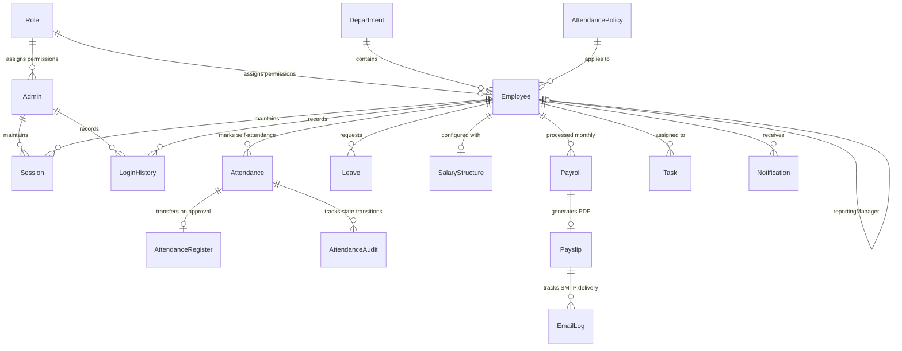

# Techneest HRMS & Payroll Backend — Database Schema Documentation

This document describes all **19 Mongoose models** (`backend/models/`), their fields, data types, validation constraints, unique constraints, compound indexes, and entity relationships.

---

## Entity-Relationship Overview

---

## 1. `Role` (`backend/models/Role.js`)
Defines role-based access control (RBAC) permissions for both Administrators and Employees.

| Field | Type | Required | Constraints / Default | Description |
| :--- | :--- | :---: | :--- | :--- |
| `name` | `String` | Yes | `unique: true`, `trim: true` | Role identifier (e.g., `Super Admin`, `HR Admin`, `Employee`) |
| `slug` | `String` | Yes | `unique: true`, `lowercase: true` | URL/code-safe slug (`super_admin`, `hr_admin`, `employee`) |
| `description` | `String` | No | `""` | Human-readable role summary |
| `permissions` | `[String]` | No | `[]` | Granular permission keys (e.g., `attendance:approve`, `payroll:finalize`, `*`) |
| `isSystemRole` | `Boolean` | No | `false` | Prevents deletion of core system roles |
| `isActive` | `Boolean` | No | `true` | Active status flag |

---

## 2. `Admin` (`backend/models/Admin.js`)
Stores administrator accounts, security lockout states, password reset tokens, and organization settings.

| Field | Type | Required | Constraints / Default | Description |
| :--- | :--- | :---: | :--- | :--- |
| `name` | `String` | Yes | `trim: true` | Administrator full name |
| `email` | `String` | Yes | `unique: true`, `lowercase: true` | Login email address |
| `password` | `String` | Yes | `select: false`, `minlength: 8` | Bcrypt-hashed password (never returned in queries) |
| `phone` | `String` | No | `""` | Contact phone number |
| `role` | `String` | No | `enum: ['Super Admin', 'Admin', 'HR Admin', 'Payroll Admin']`, default `'Super Admin'` | Admin tier |
| `roleRef` | `ObjectId` (`Role`) | No | `null` | Optional reference to custom `Role` document |
| `permissions` | `[String]` | No | `['*']` | Explicit permission overrides |
| `department` | `String` | No | `'Administration'` | Admin department |
| `designation` | `String` | No | `'System Administrator'` | Admin job title |
| `avatar` | `String` | No | `""` | Profile image path |
| `isActive` | `Boolean` | No | `true` | Account enabled flag |
| `failedLoginAttempts` | `Number` | No | `0` | Consecutive failed login counter |
| `lockUntil` | `Date` | No | `null` | Account lockout expiration timestamp |
| `lastLoginAt` | `Date` | No | `null` | UTC timestamp of most recent successful login |
| `lastLoginIp` | `String` | No | `""` | IP address of most recent login |
| `lastLoginDevice` | `String` | No | `""` | User-Agent summary of most recent login |
| `passwordChangedAt` | `Date` | No | `null` | Timestamp of last password update |
| `resetPasswordTokenHash` | `String` | No | `select: false` | SHA-256 hash of password reset token |
| `resetPasswordExpiresAt` | `Date` | No | `select: false` | Expiration timestamp for reset token |
| `organizationSettings` | `Object` | No | Nested object | Organization name, email, address, timezone (`Asia/Kolkata`), currency (`INR`), and notification preferences |

---

## 3. `Department` (`backend/models/Department.js`)
Represents organizational departments matching the frontend Department cards (`Engineering`, `Product`, `Design`, `Marketing`, `Sales`, `HR`).

| Field | Type | Required | Constraints / Default | Description |
| :--- | :--- | :---: | :--- | :--- |
| `name` | `String` | Yes | `unique: true`, `trim: true` | Department name |
| `code` | `String` | Yes | `unique: true`, `uppercase: true` | Short code (e.g., `ENG`, `HR`, `FIN`) |
| `description` | `String` | No | `""` | Department overview |
| `headName` | `String` | No | `""` | Display name of department head |
| `headEmployee` | `ObjectId` (`Employee`) | No | `null` | Reference to `Employee` leading the department |
| `budget` | `Number` | No | `0` | Allocated department budget |
| `location` | `String` | No | `""` | Office location / floor |
| `isActive` | `Boolean` | No | `true` | Whether department is active |

---

## 4. `Employee` (`backend/models/Employee.js`)
Core employee record supporting all fields in `AddEmployee.jsx`, `EditEmployee.jsx`, `ViewEmployee.jsx`, `Employee.jsx`, and `Settings.jsx`.

| Field | Type | Required | Constraints / Default | Description |
| :--- | :--- | :---: | :--- | :--- |
| `employeeId` | `String` | Yes | `unique: true`, `uppercase: true`, `index: true` | Organization employee code (e.g., `EMP001`) |
| `firstName` | `String` | Yes | `trim: true` | First name |
| `lastName` | `String` | No | `trim: true`, `""` | Last name |
| `name` | `String` | Yes | `trim: true` | Full display name (auto-synced from `firstName` + `lastName`) |
| `email` | `String` | Yes | `unique: true`, `lowercase: true`, `index: true` | Official email address |
| `password` | `String` | Yes | `select: false`, `minlength: 6` | Bcrypt-hashed login password |
| `phone` | `String` | No | `""` | Mobile number |
| `dob` | `Date` | No | `null` | Date of birth |
| `gender` | `String` | No | `enum: ['Male', 'Female', 'Other', '']` | Gender |
| `address`, `city`, `state`, `pincode` | `String` | No | `""` | Residential address fields |
| `department` | `String` | Yes | `index: true` | Department name |
| `departmentRef` | `ObjectId` (`Department`) | No | `null` | Reference to `Department` document |
| `designation` | `String` | Yes | `trim: true` | Job title / role designation |
| `reportingManager` | `ObjectId` (`Employee`) | No | `null` | Self-reference to manager `Employee` |
| `reportingManagerName` | `String` | No | `""` | Cached manager name |
| `joiningDate` | `Date` | Yes | `default: Date.now` | Date of joining |
| `employmentType` | `String` | No | `enum: ['Full-Time', 'Part-Time', 'Contract', 'Intern']`, default `'Full-Time'` | Employment category |
| `workLocation` | `String` | No | `enum: ['Office', 'Remote', 'Hybrid']`, default `'Office'` | Work mode |
| `status` | `String` | No | `enum: ['Active', 'Inactive', 'On Leave', 'Probation', 'Terminated', 'Resigned']`, default `'Active'` | Current employment status |
| `isActive` | `Boolean` | No | `true`, `index: true` | Login & payroll eligibility flag |
| `baseSalary` | `Number` | No | `0`, `min: 0` | Monthly gross/CTC summary value |
| `bankDetails` | `Object` | No | `{ accountHolderName, accountNumber, ifscCode, bankName, branchName, panNumber, uanNumber, pfNumber, esiNumber }` | Banking & statutory identifiers |
| `emergencyContact` | `Object` | No | `{ name, relationship, phone }` | Emergency contact details |
| `skills` | `[String]` | No | `[]` | Skills tags (`AddEmployee.jsx` / `ViewEmployee.jsx`) |
| `documents` | `[DocumentSubSchema]` | No | `[]` | Uploaded files (`title`, `documentType`, `fileName`, `fileUrl`, `mimeType`, `size`, `uploadedAt`) |
| `attendancePolicy` | `ObjectId` (`AttendancePolicy`) | No | `null` | Assigned shift/attendance policy |
| `leaveBalance` | `Object` | No | `{ casual: 12, sick: 10, earned: 15, unpaid: 0 }` | Leave entitlement counters |
| `failedLoginAttempts`, `lockUntil`, `lastLoginAt`, `lastLoginIp`, `lastLoginDevice` | Mixed | No | Security audit fields | Same lockout and audit tracking as `Admin` |

---

## 5. `Session` (`backend/models/Session.js`)
Tracks active and revoked JWT refresh token sessions for both Admins and Employees.

| Field | Type | Required | Constraints / Default | Description |
| :--- | :--- | :---: | :--- | :--- |
| `sessionId` | `String` | Yes | `unique: true`, `index: true` | UUID v4 session identifier |
| `subjectId` | `ObjectId` | Yes | `index: true`, `refPath: 'subjectModel'` | ID of the `Admin` or `Employee` |
| `subjectModel` | `String` | Yes | `enum: ['Admin', 'Employee']` | Polymorphic model type |
| `subjectRole` | `String` | Yes | `enum: ['admin', 'employee']` | Role type |
| `refreshTokenHash` | `String` | Yes | `select: false` | SHA-256 hash of active refresh token |
| `ipAddress` | `String` | No | `""` | Client IP address |
| `userAgent` | `String` | No | `""` | Raw User-Agent header |
| `deviceInfo` | `Object` | No | `{ browser, os, deviceType, summary }` | Parsed client device metadata |
| `status` | `String` | No | `enum: ['Active', 'LoggedOut', 'Expired', 'Revoked']`, default `'Active'` | Session lifecycle status |
| `loginAt` | `Date` | No | `default: Date.now` | Session creation UTC timestamp |
| `lastActivityAt` | `Date` | No | `default: Date.now` | Updated on authenticated API calls |
| `logoutAt` | `Date` | No | `null` | UTC timestamp when logged out or revoked |
| `expiresAt` | `Date` | Yes | `index: true` | Refresh token expiry timestamp |

---

## 6. `LoginHistory` (`backend/models/LoginHistory.js`)
Immutable login and session activity log (Section 6). **Strictly separated from attendance records.**

| Field | Type | Required | Constraints / Default | Description |
| :--- | :--- | :---: | :--- | :--- |
| `subjectId` | `ObjectId` | Yes | `index: true`, `refPath: 'subjectModel'` | Reference to `Employee` or `Admin` |
| `subjectModel` | `String` | Yes | `enum: ['Employee', 'Admin']` | Subject collection name |
| `employee` | `ObjectId` (`Employee`) | No | `index: true` | Populated when subject is an Employee |
| `employeeCode` | `String` | No | `index: true` | Employee ID code (e.g., `EMP001`) |
| `email` | `String` | Yes | `lowercase: true` | Email used during login attempt |
| `loginDate` | `String` | Yes | `index: true` | Date string in `Asia/Kolkata` (`YYYY-MM-DD`) |
| `loginTime` | `String` | Yes | — | Time string in `Asia/Kolkata` (`hh:mm:ss A`) |
| `timezone` | `String` | No | `'Asia/Kolkata'` | Reporting timezone |
| `loginTimestampUtc` | `Date` | Yes | `default: Date.now`, `index: true` | Exact UTC login timestamp |
| `logoutTimestampUtc` | `Date` | No | `null` | Exact UTC logout timestamp |
| `lastActivityAt` | `Date` | No | `default: Date.now` | Last observed API activity in session |
| `sessionDurationMinutes` | `Number` | No | `0` | Computed duration upon logout |
| `sessionId` | `String` | No | `index: true` | Linked `Session.sessionId` |
| `sessionStatus` | `String` | No | `enum: ['Active', 'Completed', 'Expired', 'Revoked', 'Failed']` | Session or attempt outcome |
| `ipAddress` | `String` | No | `""` | Client IP address |
| `deviceInfo` | `Object` | No | `{ browser, os, deviceType, userAgent, summary }` | Parsed browser/OS metadata |
| `failureReason` | `String` | No | `""` | Reason if `sessionStatus === 'Failed'` |

---

## 7. `AttendancePolicy` (`backend/models/AttendancePolicy.js`)
Configurable office timings, grace periods, half-day thresholds, overtime thresholds, and weekly offs.

| Field | Type | Required | Constraints / Default | Description |
| :--- | :--- | :---: | :--- | :--- |
| `name` | `String` | Yes | `unique: true` | Policy name (e.g., `Standard General Shift`) |
| `code` | `String` | Yes | `unique: true`, `uppercase: true` | Short code (`GEN`) |
| `shiftStartTime` | `String` | No | `'09:30'` | 24-hour shift start time (`HH:mm` IST) |
| `shiftEndTime` | `String` | No | `'18:30'` | 24-hour shift end time (`HH:mm` IST) |
| `gracePeriodMinutes` | `Number` | No | `15` | Late arrival grace window in minutes |
| `earlyExitGraceMinutes` | `Number` | No | `15` | Early departure grace window in minutes |
| `fullDayMinHours` | `Number` | No | `8` | Minimum hours required for full day credit |
| `halfDayMinHours` | `Number` | No | `4` | Minimum hours required for half day credit |
| `overtimeThresholdHours` | `Number` | No | `9` | Hours beyond which overtime accrues |
| `weeklyOffDays` | `[Number]` | No | `[0]` | Day-of-week indices (`0` = Sunday, `6` = Saturday) |
| `allowMultipleCheckIns` | `Boolean` | No | `false` | Prevents duplicate daily check-ins when `false` |
| `isDefault` | `Boolean` | No | `false` | Default organization policy |

---

## 8. `Attendance` (`backend/models/Attendance.js`)
Employee self-attendance submission and correction request record (Section 7 & 8).

- **Compound Unique Index**: `{ employee: 1, dateString: 1 }` (`unique: true`) — guarantees at most one self-attendance record per employee per calendar date (`YYYY-MM-DD`).

| Field | Type | Required | Constraints / Default | Description |
| :--- | :--- | :---: | :--- | :--- |
| `employee` | `ObjectId` (`Employee`) | Yes | `index: true` | Employee who marked attendance |
| `employeeCode` | `String` | Yes | `index: true` | Cached `employeeId` (e.g., `EMP001`) |
| `dateString` | `String` | Yes | `index: true` | IST date (`YYYY-MM-DD`) |
| `attendanceDate` | `Date` | Yes | — | Start-of-day UTC date |
| `checkInUtc` | `Date` | No | `null` | Server-generated UTC check-in timestamp |
| `checkOutUtc` | `Date` | No | `null` | Server-generated UTC check-out timestamp |
| `checkInIst` | `String` | No | `""` | Formatted IST check-in time (`hh:mm A`) |
| `checkOutIst` | `String` | No | `""` | Formatted IST check-out time (`hh:mm A`) |
| `workingMinutes` | `Number` | No | `0` | Total worked duration in minutes |
| `workingHours` | `Number` | No | `0` | Decimal worked hours (e.g., `8.5`) |
| `isLateArrival` | `Boolean` | No | `false` | True if check-in exceeds shift start + grace period |
| `lateMinutes` | `Number` | No | `0` | Minutes late beyond shift start |
| `isEarlyCheckout` | `Boolean` | No | `false` | True if check-out is before shift end - grace period |
| `earlyCheckoutMinutes` | `Number` | No | `0` | Minutes early before shift end |
| `isHalfDay` | `Boolean` | No | `false` | True if hours worked fall into half-day band |
| `overtimeMinutes` | `Number` | No | `0` | Overtime duration in minutes |
| `overtimeHours` | `Number` | No | `0` | Decimal overtime hours |
| `attendanceStatus` | `String` | No | `enum: ['Present', 'Late', 'Half Day', 'Absent', 'On Leave', 'Holiday', 'Weekly Off']` | Computed attendance classification |
| `approvalStatus` | `String` | No | `enum: ['Pending', 'Approved', 'Rejected', 'Correction Requested']`, default `'Pending'`, `index: true` | Admin approval workflow state |
| `workLocation` | `String` | No | `'Office'` | Work mode (`Office`, `Remote`, `Hybrid`) |
| `employeeNotes` | `String` | No | `""` | Notes provided at check-in/out |
| `correctionRequest` | `Object` | No | `{ isRequested, originalCheckInUtc, originalCheckOutUtc, requestedCheckInUtc, requestedCheckOutUtc, reason, requestedAt, status, reviewedBy, reviewedAt, reviewRemarks }` | Preserves both original and requested timestamps |
| `reviewedBy` | `ObjectId` (`Admin`) | No | `null` | Admin who approved/rejected |
| `reviewedAt` | `Date` | No | `null` | UTC timestamp of admin review |
| `reviewRemarks` | `String` | No | `""` | Approval remarks or rejection reason |
| `registerEntry` | `ObjectId` (`AttendanceRegister`) | No | `null` | Link to official `AttendanceRegister` entry once approved |

---

## 9. `AttendanceRegister` (`backend/models/AttendanceRegister.js`)
Official Attendance Register ("Main Sheet") containing **only** Admin-approved attendance entries (Section 8). Payroll calculations read exclusively from this collection.

- **Compound Unique Index**: `{ employee: 1, dateString: 1 }` (`unique: true`) — strictly prevents duplicate approved attendance entries for the same employee and date.

| Field | Type | Required | Constraints / Default | Description |
| :--- | :--- | :---: | :--- | :--- |
| `employee` | `ObjectId` (`Employee`) | Yes | `index: true` | Employee reference |
| `employeeCode` | `String` | Yes | `index: true` | Cached employee code |
| `sourceAttendance` | `ObjectId` (`Attendance`) | Yes | `unique: true` | Reference to source `Attendance` record |
| `dateString` | `String` | Yes | `index: true` | IST date (`YYYY-MM-DD`) |
| `month` | `Number` | Yes | `index: true` | Calendar month (`1`–`12`) |
| `year` | `Number` | Yes | `index: true` | Calendar year (e.g., `2025`) |
| `checkInUtc` / `checkOutUtc` | `Date` | No | — | Approved check-in and check-out UTC timestamps |
| `checkInIst` / `checkOutIst` | `String` | No | — | Approved IST display times |
| `workingHours` | `Number` | No | `0` | Approved working hours |
| `overtimeHours` | `Number` | No | `0` | Approved overtime hours |
| `status` | `String` | Yes | `enum: ['Present', 'Late', 'Half Day', 'Absent', 'On Leave', 'Holiday', 'Weekly Off']` | Official attendance status |
| `dayCredit` | `Number` | Yes | `enum: [0, 0.5, 1]`, default `1` | Payable day weight (`1` full day, `0.5` half day, `0` unpaid) |
| `approvedBy` | `ObjectId` (`Admin`) | Yes | — | Authorizing Administrator |
| `approvedAt` | `Date` | Yes | `default: Date.now` | Approval timestamp |
| `approvalRemarks` | `String` | No | `""` | Admin approval notes |
| `isLockedForPayroll` | `Boolean` | No | `false` | Locked once monthly payroll is finalized |

---

## 10. `AttendanceAudit` (`backend/models/AttendanceAudit.js`)
Permanent, append-only audit trail for every attendance lifecycle transition (`CHECK_IN`, `CHECK_OUT`, `CORRECTION_REQUESTED`, `APPROVED`, `REJECTED`, `CORRECTION_APPROVED`, `CORRECTION_REJECTED`, `ADMIN_MANUAL_ENTRY`).

---

## 11. `Leave` (`backend/models/Leave.js`)
Tracks employee leave applications (`Casual`, `Sick`, `Earned`, `Unpaid`, `Maternity`, `Paternity`), total days, half-day flags, and Admin approval status (`Pending`, `Approved`, `Rejected`, `Cancelled`).

---

## 12. `Holiday` (`backend/models/Holiday.js`)
Stores organization holidays (`dateString` unique `YYYY-MM-DD`, `name`, `type: ['National', 'Festival', 'Company', 'Optional']`, `isPaid: true`).

---

## 13. `SalaryStructure` (`backend/models/SalaryStructure.js`)
Configurable per-employee salary structure and payroll policy rules (Section 9).

| Field | Type | Required | Constraints / Default | Description |
| :--- | :--- | :---: | :--- | :--- |
| `employee` | `ObjectId` (`Employee`) | Yes | `unique: true`, `index: true` | One active structure per employee |
| `effectiveFrom` | `Date` | No | `default: Date.now` | Effective start date |
| `calculationBasis` | `String` | No | `enum: ['CALENDAR_DAYS', 'WORKING_DAYS', 'FIXED_30_DAYS']`, default `'CALENDAR_DAYS'` | Denominator basis for per-day rate calculation |
| `basicSalary` | `Number` | Yes | `min: 0` | Monthly Basic Salary (INR) |
| `hra` | `Number` | No | `0` | House Rent Allowance |
| `da` | `Number` | No | `0` | Dearness Allowance |
| `specialAllowance` | `Number` | No | `0` | Special Allowance |
| `conveyanceAllowance` | `Number` | No | `0` | Conveyance Allowance |
| `medicalAllowance` | `Number` | No | `0` | Medical Allowance |
| `otherAllowances` | `Number` | No | `0` | Other recurring allowances |
| `pfConfig` | `Object` | No | `{ enabled: true, employeeRatePercent: 12, employerRatePercent: 12, wageCeiling: 15000, capAtCeiling: true }` | Provident Fund rules |
| `esiConfig` | `Object` | No | `{ enabled: false, employeeRatePercent: 0.75, employerRatePercent: 3.25, grossCeiling: 21000 }` | ESI rules |
| `professionalTaxConfig` | `Object` | No | `{ enabled: true, monthlyAmount: 200 }` | Professional Tax rules |
| `tdsPercent` | `Number` | No | `0` | Monthly TDS deduction percentage |
| `overtimeConfig` | `Object` | No | `{ enabled: true, hourlyMultiplier: 1.5 }` | Overtime rate multiplier |
| `latePenaltyConfig` | `Object` | No | `{ enabled: false, lateMarksPerHalfDayCut: 3 }` | Optional late mark penalty rule |

---

## 14. `Payroll` (`backend/models/Payroll.js`)
Monthly employee payroll record supporting Draft -> Approved -> Finalized lifecycle and separate payment tracking (Section 9).

- **Compound Unique Index**: `{ employee: 1, month: 1, year: 1 }` (`unique: true`) — prevents duplicate payroll records for the same employee and period.

| Field | Type | Required | Constraints / Default | Description |
| :--- | :--- | :---: | :--- | :--- |
| `employee` | `ObjectId` (`Employee`) | Yes | `index: true` | Employee reference |
| `employeeCode` | `String` | Yes | `index: true` | Cached employee code |
| `month` / `year` | `Number` | Yes | `index: true` | Payroll period (`month`: 1–12, `year`: e.g. 2025) |
| `periodLabel` | `String` | Yes | — | Human-readable label (e.g., `March 2025`) |
| `attendanceBreakdown` | `Object` | Yes | `{ totalDaysInMonth, workingDaysInMonth, weeklyOffDays, holidays, presentDays, lateDays, halfDays, paidLeaveDays, unpaidLeaveDays, absentDays, lopDays, payableDays, overtimeHours }` | Exact attendance & leave metrics used for calculation |
| `earnings` | `Object` | Yes | `{ basic, hra, da, specialAllowance, conveyanceAllowance, medicalAllowance, otherAllowances, overtimePay, bonus, incentives, arrears, grossEarnings }` | Prorated & variable earnings in INR |
| `deductions` | `Object` | Yes | `{ pfEmployee, pfEmployer, esiEmployee, esiEmployer, professionalTax, tds, lopDeduction, loanRecovery, otherDeductions, totalDeductions }` | Statutory & custom deductions in INR |
| `netPayable` | `Number` | Yes | `min: 0` | Final rounded INR net salary (`grossEarnings - totalDeductions`) |
| `adjustments` | `[AdjustmentSubSchema]` | No | `[]` | Audited manual adjustments before finalization (`type`, `category`, `amount`, `reason`, `addedBy`) |
| `payrollStatus` | `String` | No | `enum: ['Draft', 'Approved', 'Finalized', 'Reversed']`, default `'Draft'`, `index: true` | Workflow status |
| `isLocked` | `Boolean` | No | `false` | True once `Finalized`; prevents recalculation or mutation |
| `immutableSnapshot` | `Object` | No | `null` | Frozen snapshot of employee, bank, structure, earnings, and deductions at finalization |
| `paymentStatus` | `String` | No | `enum: ['Pending', 'Processing', 'Paid', 'Failed']`, default `'Pending'`, `index: true` | **Tracked separately from `payrollStatus`** |
| `paymentReference`, `paymentMethod`, `paidAt` | Mixed | No | — | Bank transfer UTR / reference tracking |

---

## 15. `Payslip` (`backend/models/Payslip.js`)
Stores generated salary slip metadata, PDF file path (`backend/uploads/payslips/`), unique `payslipNumber`, and email dispatch status.

---

## 16. `EmailLog` (`backend/models/EmailLog.js`)
Tracks every SMTP email delivery attempt (`recipientEmail`, `subject`, `templateName`, `status: ['Queued', 'Sent', 'Simulated', 'Failed']`, `messageId`, `attemptCount`, `errorMessage`).

---

## 17. `Task` (`backend/models/Task.js`)
Supports Admin task assignment (`AssignTask.jsx`, `AllTask.jsx`) and Employee task creation/updates (`CreateTask.jsx`, `EmployeeAllTask.jsx`). Includes `title`, `description`, `category`, `assignedTo` (`Employee`), `priority` (`Low`, `Medium`, `High`, `Urgent`), `status` (`Pending`, `In Progress`, `Completed`, `Overdue`), `progress` (`0`–`100`), `subtasks`, and `comments`.

---

## 18. `Notification` (`backend/models/Notification.js`)
In-app notifications for Admins and Employees (`recipientId`, `recipientRole`, `title`, `message`, `type`, `isRead`, `readAt`).

---

## 19. `AuditLog` (`backend/models/AuditLog.js`)
System-wide security and administrative audit trail recording actor, action, target entity, before/after metadata, IP address, and User-Agent.
